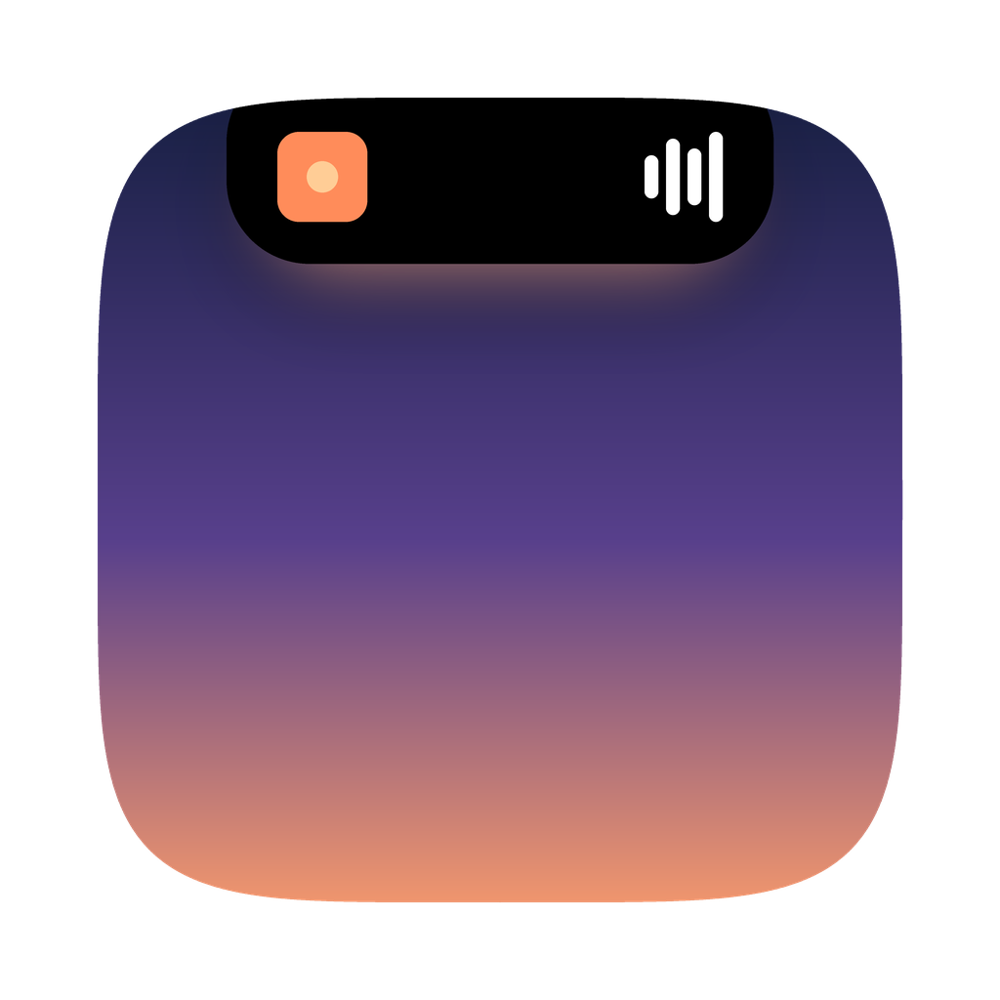

<p align="center"></p>

# NotchIsland

A Dynamic Island for the MacBook notch, written in SwiftUI, inspired by Halo. Free and open source. Requires macOS 15 or later.

## Download

1. Download **NotchIsland.dmg** from the [latest release](../../releases/latest).
2. Open it and drag **NotchIsland** into **Applications**.
3. Open NotchIsland. macOS will say it can't verify the app, because it isn't notarized by Apple. Go to **System Settings → Privacy & Security**, scroll down and click **Open Anyway**. You only do this once.
4. Turn NotchIsland on under **Privacy & Security → Accessibility** when asked (see Permissions below).

Works on Apple silicon and Intel Macs, with or without a notch.

## What's in the notch

**When nothing's happening** it's just the notch. When something is, it grows "ears" on each side, in this order of priority:

| What | Left | Right |
|---|---|---|
| Volume / brightness keys | speaker or sun | level bar |
| Charging, low battery, screenshot, download, timer done | icon | % or file name |
| Claude Code needs your permission | ✋ | Needs you (plus a sound) |
| A call (any app using the mic) | app icon | how long |
| Focus timer | timer | countdown |
| Claude Code working | ✦ | elapsed time |
| Music | album art | equalizer |

Plus three bigger pop-outs under the notch: **notification banners** (click to open), **live dictation** text, and optionally the **current lyric line**.

**Hover to open.** Six tabs:

- **Home**: iPhone-style Now Playing (drag the bar to seek, shuffle, repeat, lyrics button) next to today's date and your next event.
- **Widgets**: weather, system stats, stocks & crypto, countdowns, or your own script (see below).
- **Reminders**: check off or add reminders.
- **Shelf**: drag any file onto the notch to park it. New screenshots and downloads land here automatically. Drag out, double-click to open, right-click for AirDrop.
- **Clipboard**: your last 30 copies. Click one to copy it again. Kept in memory only, and copies from password managers are skipped.
- **Focus timer**: 5/15/25/50 minutes.
- **Claude Code**: live sessions, what each one is doing, and how long.

The ☕ button in the top bar keeps your Mac awake.

**Right-click the notch** (or click the capsule in the menu bar) for settings: lyrics under the notch, notifications, volume HUD, hide in fullscreen, keep awake, dictation key, Connect Claude Code, Quit.

## Build from source

```bash
git clone https://github.com/stansergheev/NotchIsland.git
cd NotchIsland
./build.sh --install
```

That compiles, replaces the copy in Applications and opens it. Use `./build.sh --run` to test without installing, or `./build.sh --dmg` to make the disk image. Needs Xcode or the Command Line Tools (`xcode-select --install`).

To publish an update, raise `CFBundleShortVersionString` in `Info.plist` (for example to `2.0.1`) and push to `main`. GitHub builds the disk image on a Mac and publishes it as a new release.

## Permissions (first launch)

| Permission | For | When it asks |
|---|---|---|
| **Accessibility** | volume/brightness HUD, dictation, notifications, fullscreen hiding | at launch. Turn NotchIsland on in System Settings → Privacy & Security → Accessibility. It starts working within a few seconds, no restart needed. |
| Automation | controlling Spotify / Music | first time music plays |
| Reminders, Calendars | Reminders tab, next event | at launch |
| Downloads folder | downloads on the shelf | at launch |
| Microphone, Speech Recognition | dictation | the first time you hold the dictation key |

**After every update or rebuild, Accessibility has to be turned on again.** Each build has a new signature, so the old approval stops working. When building from source, `build.sh` clears it so macOS asks again.

## Widgets

Open the Widgets tab (the grid icon) and click **+**. Right-click a widget to edit, refresh or remove it. Widgets only refresh while the tab is open.

| Widget | Shows | Data from |
|---|---|---|
| Weather | temperature, high and low for a city you pick | [Open-Meteo](https://open-meteo.com) (free, no account) |
| System stats | CPU, memory, free disk space, network speed | your Mac |
| Stocks & crypto | price, today's change, and a chart for up to 3 tickers (`AAPL`, `BTC-USD`) | Yahoo Finance's public chart data |
| Countdown | days, hours or minutes until a date | your Mac |
| Script | the output of any command you write | your Mac |

**Make your own with a script widget.** It runs a command in zsh every so often (you choose how often, minimum 5 seconds). The first line of output is shown big, and the next two lines small. Some ideas:

```bash
curl -s "wttr.in/?format=%c+%t"                              # weather without an account
pmset -g batt | grep -o '[0-9]*%'                             # battery percentage
osascript -e 'tell application "Mail" to unread count of inbox'   # unread mail
gh pr list --author @me | wc -l | xargs echo "open PRs:"      # your open pull requests
```

Only add commands you trust: they run with your permissions.

Your widgets are saved in `~/.notchisland/widgets.json`, so you can also edit them by hand (+ menu → **Open widgets file…**) or copy the file to another Mac. Example:

```json
[
  { "kind": "system" },
  { "kind": "weather", "place": "New York", "latitude": 40.71, "longitude": -74.01 },
  { "kind": "stocks", "symbols": ["AAPL", "BTC-USD"] },
  { "kind": "countdown", "title": "Finals", "date": "2026-12-14" },
  { "kind": "script", "title": "Battery", "command": "pmset -g batt | grep -o '[0-9]*%'", "interval": 60 }
]
```

## Dictation

Hold **Fn (🌐)**, talk, let go. Your words are typed wherever the cursor is. Change the key (or turn it off) from the right-click menu.

If holding Fn opens the emoji picker or switches keyboards, go to System Settings → Keyboard and set **"Press 🌐 key to"** to **Do Nothing**. Or switch dictation to right Option.

## Claude Code

Open the Claude Code tab and click **Connect Claude Code** (or use the right-click menu). This adds hooks to `~/.claude/settings.json` (a backup is saved next to it as `settings.json.notchisland-backup`). Each hook writes a tiny file to `~/.notchisland/events` that NotchIsland reads and deletes. Nothing leaves your Mac. Already-open Claude Code sessions need a restart to pick up the hooks. **Disconnect** removes only NotchIsland's hooks.

## Launch at login

Add NotchIsland in System Settings → General → Login Items & Extensions → Open at Login.

## Troubleshooting

- **Volume or brightness keys show the normal macOS pop-up**: Accessibility isn't on yet (see above). External speakers that don't support software volume also fall back to macOS.
- **No notification banners in the notch**: needs Accessibility. Notification Center's layout changes between macOS versions, so this feature is the most likely to need adjusting on yours. The normal macOS banner still shows too.
- **Music isn't showing**: System Settings → Privacy & Security → Automation, allow NotchIsland to control Spotify / Music.
- **Permissions act strange**: reset all of them and relaunch:
  ```bash
  for s in Accessibility AppleEvents Reminders Calendar Microphone SpeechRecognition; do tccutil reset $s com.example.notchisland; done
  ```

## Known limits

- Music works with Spotify and Apple Music, not browser audio.
- Lyrics come from LRCLIB, a free lyrics database. Only the song title, artist, album and length are sent.
- Some FaceTime calls may not show in the call indicator, because the mic is used by a system process rather than the FaceTime app.
